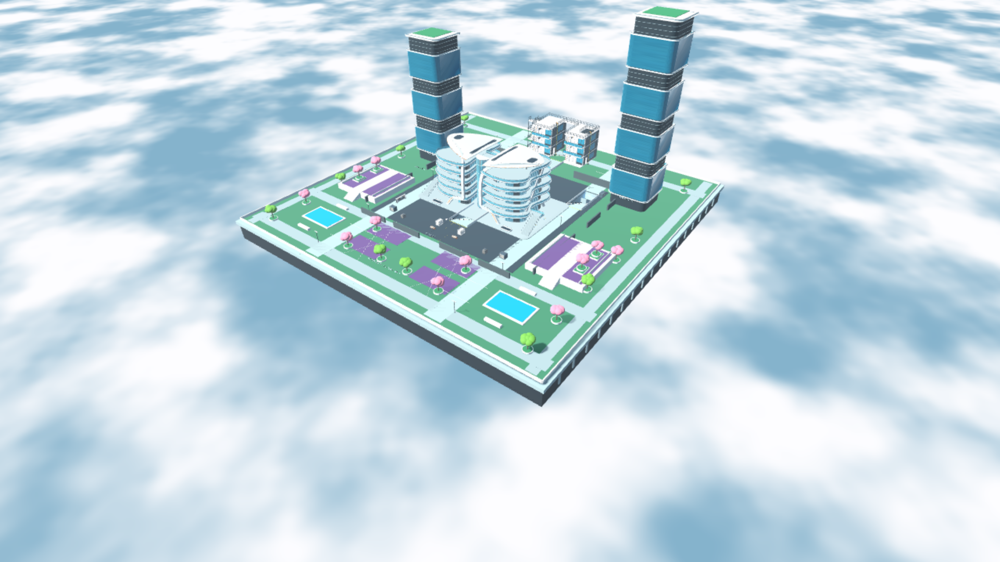

# 关卡设计作品集 · Level Design Portfolio

> 三份商业游戏关卡分析（一份方法论、两份案例拆解），加一个自己搭出来、能跑起来的 Apex 风格 POI。
> 目标不是复述「这关很好玩」，而是把好玩的机制拆成**能写进需求文档、能拿去做验收**的东西。

---

## 内容

| # | 文档 | 类型 | 体量 | 打开 |
|:-:|---|---|---|---|
| 1 | **Apex 风格关卡设计方法论** | 方法论 / 框架 | 约 1.7 万字 · 16 节 + 附录 A | [Markdown](docs/apex-level-design-methodology.md) |
| 2 | **《塞尔达传说：旷野之息》关卡设计分析报告** | 案例拆解 / 开放世界 | 约 1.8 万字 · 12 节 + 2 附录 | [Markdown](docs/zelda-botw-level-design-analysis.md) |
| 3 | **原版愤怒小鸟关卡设计分析** | 案例拆解 / 休闲物理 | 10 页 · 含截图与流程图 | [PDF](docs/angry-birds-level-design-analysis.pdf) · [Word 源文件](docs/angry-birds-level-design-analysis.docx) |
| 4 | **双塔广场：一个 Apex 风格 POI** | 设计实践 / 可运行关卡 | 约 100 × 100 m · Godot 场景 | [案例说明](docs/poi/twin-plaza.md) |

---

## 从分析到实践：双塔广场



方法论不是写完就完了。我用它在 Godot 4.6 里搭了一个可运行的 POI：双塔当幕布，把广场切成五条走廊；中央双壳做 commit 点；最后主题化成奥林匹斯空中花园。

- 体验定义 → 拓扑 → 高差 → 掩体 → 主题化，每一步都能追回到方法论的具体条款（切分、咽喉点、量化标尺、信息层）
- 中途推翻过一次判断：把「双塔当制高点」改成「双塔当视线墙」，整套拓扑重做了一遍
- 走廊时间、战斗剖面、验证脚本结果都写进了文档，没做过的验证也如实标注

[完整设计过程](docs/poi/twin-plaza.md)

---

## 三份文档怎么配合

三份不是并列的三篇作文，而是一条从**案例**到**方法**的链路：

```
愤怒小鸟  ──┐  同一套机制，如何从「精准打击」演化成「连锁流向」
            ├─→ 案例提供证据
旷野之息  ──┘  开放世界如何用视线、地形、奖励组织自主探索
                    │
                    ▼
            Apex 方法论  把证据抽象成可复用的分层框架：
                         宏观全图 → 中观 POI → 微观房区 → 连接层 → 信息层
                         再落到量化标尺、迭代手册、反模式清单、验收检查表
```

方法论第 16 节与附录 A 专门处理**迁移**：把大逃杀的框架裁剪到小规模 FPS，说明哪些原则与人数的无关、哪些机制必须删。

---

## 建议阅读路径

| 时间 | 读什么 | 能看到什么 |
|---|---|---|
| **10 分钟** | [Apex 方法论 · 第 0 节](docs/apex-level-design-methodology.md#0-一句话结论) + [第 14 节一页速查卡](docs/apex-level-design-methodology.md#14-一页速查卡) | 一句话结论：关卡是「制造可预期冲突的机器」，以及拉力/推力/切分/计时四个部件 |
| **30 分钟** | 加上 [旷野之息 · 阅读摘要](docs/zelda-botw-level-design-analysis.md#阅读摘要) 与 [第 3 节初始台地](docs/zelda-botw-level-design-analysis.md#3-初始台地如何把玩家教到能够自由探索) | 教学如何从「给提示」过渡到「玩家主动复用知识」 |
| **深读** | [愤怒小鸟 PDF](docs/angry-birds-level-design-analysis.pdf) + 方法论第 3–10 节 | 一个品类内的代际演化，以及可执行的迭代手册 |
| **看落地** | [双塔广场 POI](docs/poi/twin-plaza.md) | 同一套方法怎么变成一个能跑的关卡：体验 → 拓扑 → 主题化的完整推演 |

---

## 分析方法

三份文档共用同一套做法，这也是我认为它们能直接用于项目的原因：

1. **证据分层。** 区分「实录观察」「公开资料」「分析判断」，并在文中标注。开发者访谈只用来解释设计方向，攻略只用来核对机制，不用来倒推制作组意图。
2. **多尺度拆解。** 不从「这一关」开始，而从全图节奏 → 兴趣点 → 房区掩体 → 连接空间 → 信息传达，逐层往下拆。
3. **结论必须可执行。** 每条判断都尽量落到设计约束、量化标尺或「症状 → 处方」的排查表，而不是停在感受描述。
4. **不编数据。** 文中没有虚构的热力图、留存率、死亡统计；定性结论会明确写成定性。

---

## 文档状态

| 文档 | 状态 |
|---|---|
| 旷野之息 | 完成版。覆盖复苏神庙、初始台地、卓拉、格鲁德、克洛格森林、利特、死亡之山等区域，附证据口径说明 |
| Apex 方法论 | v0.1。框架与检查表已完整，第 16 节保留了实测补充位，后续按项目反馈迭代 |
| 愤怒小鸟 | 按可得内容完成。原始手稿在第 5.2 节处中断，未收录部分未做虚构补写 |
| 双塔广场 POI | 可运行场景 + 设计说明。花园、主楼、HUD 检查 0 失败；多人实战、缩圈与热力图验证尚未进行 |

---

## 仓库结构

```
.
├── README.md
└── docs/
    ├── apex-level-design-methodology.md          # 方法论
    ├── zelda-botw-level-design-analysis.md       # 开放世界案例
    ├── angry-birds-level-design-analysis.pdf     # 休闲物理案例（阅读版）
    ├── angry-birds-level-design-analysis.docx    # 同上，Word 源文件
    └── poi/
        ├── twin-plaza.md                        # POI 设计实践
        └── images/                              # 总览、顶视图、拓扑图
```

---

## 相关项目

- **[CONQUER! 征服](https://github.com/Tinker-TK/conquer)** —— 个人开发的卡牌构筑战棋 Roguelike（Godot 4.6）：44 兵种 / 61 卡牌 / 66 遗物，16 层路线、战棋部署、四层地形与自研内容生产工具链。可下载 Windows 试玩包。

---

## 关于

求职方向：**关卡设计**　·　GitHub：[@Tinker-TK](https://github.com/Tinker-TK)

如果对我的分析有不同看法，欢迎开 Issue 讨论——尤其是第 16 节「待补充」里那些只有实战才能验证的部分。

---

## 版权说明

文中涉及的游戏名称、截图与商标归各自版权方所有，仅用于设计研究与作品展示，不构成官方资料。分析结论为个人观点。
