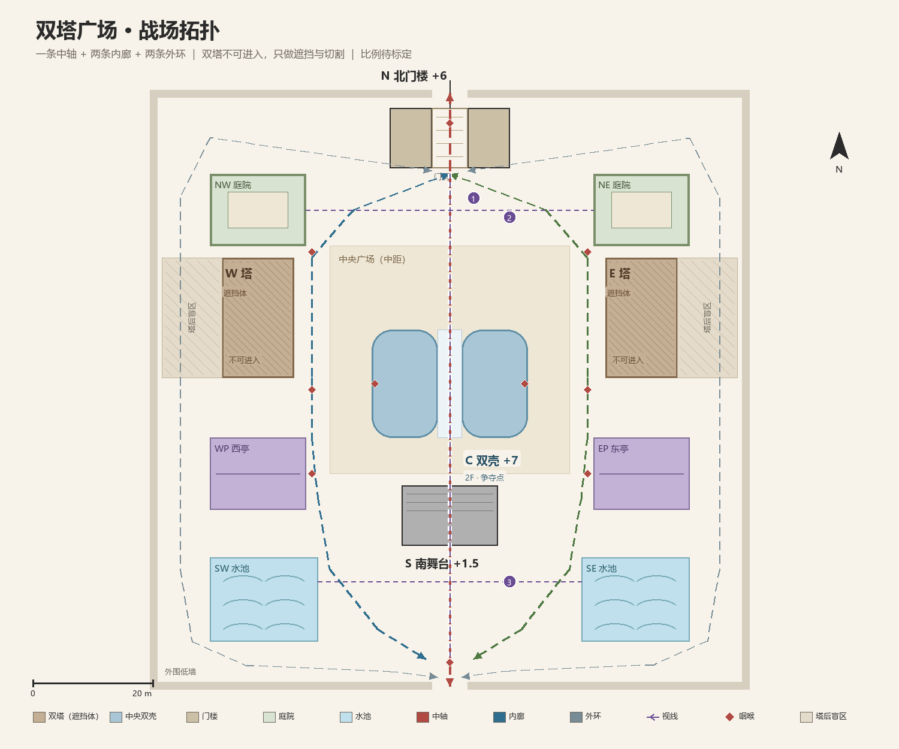

# 双塔广场：一个 Apex 风格 POI 的设计过程（迭代中）

> 从灰盒到主题化的完整实践：先定体验，再定拓扑，最后才做美术。
> 方法论依据：[Apex 风格关卡设计方法论 v0.1](../apex-level-design-methodology.md)。

## 概览

| 项目 | 内容 |
|---|---|
| 类型 | Apex 风格竞技 FPS 的中型 POI（练习项目） |
| 体量 | 战斗区约 100 × 100 m，置于 180 × 180 m 悬浮平台之上 |
| 建议人数 | 8v8（五条走廊对 6v6 偏大） |
| 单局时长 | 8–12 分钟 |
| 引擎 | Godot 4.6，复用项目内 Apex 物件 + 自制奥林匹斯风格模块 |
| 我的工作 | 布局、拓扑、高差、掩体、主题化、验证脚本 |

这个 POI 不是「画一张好看的地图」，而是按方法论的四段顺序推出来的：**定体验 → 定结构 → 定细节 → 验证**。中间有一次关键判断被推翻，重做了一版拓扑——那部分才是这篇文档的重点。

---

## 1. 先定体验，再画第一条线

**一句话 Fantasy**：

> 两座纪念碑把广场切成五条街：中轴是仪式大道，内廊是后台通道，外环是花园小径；中央双壳是祭台，塔后是盲区。

**关键词**：对称、遮挡、绕行。

**三条可验收的体验目标**

1. **30 秒读图**：开局能读懂「一条中轴 + 两条内廊 + 两条外环」，以及两块塔后盲区。
2. **每次交战都有「绕塔」选择**：内廊快而暴露、外环慢而安全，两条路的时间差就是这张图的节奏旋钮。
3. **中央双壳是 commit 点**：进去之后 20–60 秒内决出胜负，塔让「撤退」变贵，逼你在进之前想清楚。

**反目标（明确不做）**

- 不做「绕塔转圈」：两队隔着塔绕 60 秒不交战，节奏崩。
- 不做「塔后死区」：盲区没有目的，玩家永远不去。
- 不做「单向视野」：塔角一侧能看、一侧不能看，等于白送防守方一个优势。

对应方法论的 §2（流、节拍、注意力）与 §4（中观层 POI）：POI 不是一堆掩体，而是**推、拉、切分、计时**四个部件在这一块地上的具体配置。

---

## 2. 一次关键修正：塔是幕布，不是看台

第一版我把双塔当成「制高点」，体验定成了「抢塔—反塔」的垂直攻防。但实际需求是：**塔不可进入，只用来挡视线、切分空间**。

这个修正把整个设计翻了一遍：

| 维度 | v0.1 的误判 | v0.2 的实际 |
|---|---|---|
| 双塔角色 | 制高点、狙击位 | **视线墙**、空间切割体 |
| 主要枪线 | 塔对塔的长枪线 | 中段东西向枪线被切断，只剩三条横线 |
| 咽喉 | 塔基楼梯 | 塔的北角 / 南角 |
| 体验 | 垂直三层 | **地面五条走廊** |
| 主戏 | 长枪 | 近中距（CQC 50%） |

**为什么这个修正反而是好事**：可上人的高塔在 Apex 里很容易变成「又难攻、又全视野」的牢笼，逼所有人绕开；不可上的塔反而把战斗压回地面，让「绕」成为主玩法。这也符合方法论 §1 的约束——**垂直度必须配保底路线**；当保底路线做不出来时，取消垂直度比硬加更干净。

---

## 3. 拓扑：五走廊、三视线、两盲区

**五条走廊**

| 走廊 | 速度（疾跑估算） | 暴露 | 用途 |
|---|---|---|---|
| 中轴 | 12–18 秒 | 最高，全线可见 | 快攻、抢点 |
| 西 / 东内廊 | 16–24 秒 | 中高，塔角与广场双向 | 贴塔推进、控场 |
| 西 / 东外环 | 24–34 秒 | 低，但塔后无视野 | 绕后、避战、残局 |

**关键设计**：内廊与外环是同一侧的两条路，**时间差 6–10 秒、风险不同**。这个差值就是「要不要绕」的决策来源；差值太小外环没人走，差值太大内廊没人走。

**三条视线**：中轴（北门 → 南门）、北横（两庭院之间）、南横（两水池之间）。塔把中段所有东西向枪线切断，长枪只能在这三条横线上成立——这就是为什么战斗剖面能压到 50% CQC。

**两块盲区**：塔后约 10 × 20 m。它们是绕后路线，也是这张图最危险的地方——进去就失去信息。所以盲区必须有「理由」（资源、捷径或目标），否则会退化成死区。

**咽喉点**：南北门、塔北角 / 塔南角（内廊与外环的必经转折）、双壳的三个入口、亭子通道。对应方法论 §6 的连接层：咽喉点的价值不在于窄，而在于**它决定了两条路之间能不能互相支援**。

---

## 4. 战斗剖面：50 / 35 / 15

| 距离带 | 占比 | 发生地 |
|---|---|---|
| 0–15 m | **50%** | 双壳内部、亭内、塔角 |
| 15–40 m | **35%** | 内廊、广场、外环过渡带 |
| 40–100 m | **15%** | 中轴、北横、南横 |

**两条判断线**（来自方法论 §8 的量化标尺）：

- 长距 > 25%：说明塔的遮挡不够，或者南北横线太宽，这张图会退化成对狙图。
- CQC < 45%：说明双壳太小、入口太多，玩家会直接绕过去。

---

## 5. 从灰盒到奥林匹斯：主题化改了什么

主题化不是贴材质，而是**用美术解决设计问题**：

| 改动 | 设计目的 |
|---|---|
| 地面抬到云海之上，外圈做护栏 | 边界从「一堵墙」变成「坠落」，玩家不需要被告知也会沿着护栏走 |
| 东西花园抬高 3 m，十级 0.3 m 台阶 | 给外环一个「高差呼吸」，但高度不足以变成第二个狙击点 |
| 水池、紫色铺装、粉色/绿色树冠 | 用地表颜色做路径编码，玩家靠颜色就能判断「这是外环还是内廊」 |
| 双塔做玻璃幕墙 + 绿色屋顶 | 地标可读性：一句「西塔后面」就能完成报点 |
| 保留原中央双壳主楼 | 控制成本：CQC 闭环沿用已验证的体块，只改外圈与主题 |

这些改动对应方法论 §7 的信息层：**让地图自己说话**，而不是靠 UI 教玩家怎么走。

---

## 6. 量化与验证

| 项目 | 数值 / 结果 |
|---|---|
| 平台尺寸 | 约 180 × 180 m |
| 战斗区 | 约 100 × 100 m |
| 花园高差 | +3 m，10 级 × 0.3 m，可直接步行 |
| 玩家参数 | 步行 6.5 m/s，疾跑 9.5 m/s |
| 花园与边界检查 | `check_sky_gardens.gd`，0 失败 |
| 主楼楼梯 / 滑索检查 | `check_main_building.gd`，0 失败 |
| 第一人称与 HUD | `check_first_person_hud.gd`，0 失败 |

**尚未完成的验证**（如实标注）：多人实战、缩圈、五走廊使用率热力图、塔后停留占比、中央 3v3 时长。拓扑里的走廊时间是按移速估算，不是实测。

下一步的灰盒测试计划：8v8 跑四组脚本（跑图 / 3v3 攻防 / 8 队混战 / 反向测试），重点看三条指标——内廊与外环的时间差是否落在 6–10 秒、塔后停留是否低于 15%、中央交火是否稳定在 20–60 秒。

---

## 7. 决策与代价

| 决策 | 依据 | 代价 / 风险 |
|---|---|---|
| 双塔不可进入 | 高塔容易变成单向收割点 | 少了一个垂直战术层，靠双壳补 |
| 强左右镜像 | 竞技图公平、易读 | 容易镜像僵局，需要中立目标打破 |
| 五条走廊 | 多点交火、重玩性 | 对 6v6 偏大，建议 8v8 |
| 中央双壳做 commit 点 | 全场唯一 CQC 闭环 | 入口太多会变成可绕开的装饰 |
| 花园只抬 3 m | 高差呼吸，不抢中央 | 外环视野仍偏弱，需要靠掩体补 |

---

## 8. 已知局限

- 双塔目前只有外部体块与碰撞，没有室内楼层——它是纯粹的「幕布」，不是可进入建筑。
- 地图完全镜像，缺少中立目标，长局容易打成对称僵持。
- 主题化之后没有重新测掩体密度，CQC 的实际手感仍是估算。
- 场景依赖项目内的 Apex 本地素材与自制奥林匹斯模块，**不随本文档分发**。

---

## 9. 文件与复现

| 内容 | 位置（本地工程） |
|---|---|
| 关卡场景 | `scenes/level_01.tscn` |
| 奥林匹斯模块生成 | `tools/build_olympus_sky_gardens.py` |
| 验证脚本 | `check_sky_gardens.gd`、`check_main_building.gd`、`check_first_person_hud.gd` |
| 总览渲染 | 本文 `images/overview.png` |
| 顶视图 | 本文 `images/top-view.png` |

方法论的完整框架见 [Apex 风格关卡设计方法论](../apex-level-design-methodology.md)。
